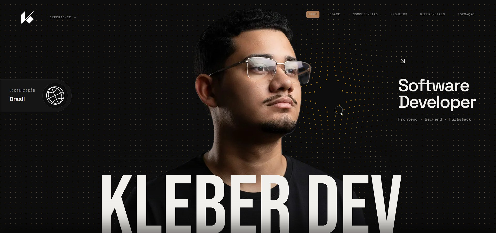
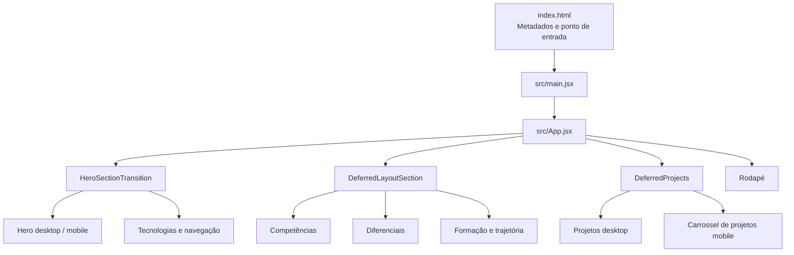
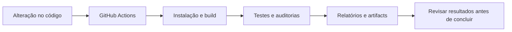

# KLEBER DEV — Portfólio pessoal

<p align="center">
  <a href="https://kleber-goncalves-dev.vercel.app/" target="_blank">
    
  </a>
</p>

<p align="center">
  <strong>Desenvolvimento web, decisões técnicas e identidade visual em um portfólio autoral.</strong>
  <br />
  Um espaço para apresentar meus projetos, competências, ferramentas e trajetória em tecnologia.
</p>

<p align="center">
  <a href="https://kleber-goncalves-dev.vercel.app/">Acessar portfólio</a>
  &nbsp;·&nbsp;
  <a href="https://github.com/kleber-goncalves">GitHub</a>
  &nbsp;·&nbsp;
  <a href="https://www.linkedin.com/in/kleber-goncalve-s/">LinkedIn</a>
</p>

<p align="center">
  
  
  
  
  
</p>

<p align="center">
  <a href="https://github.com/kleber-goncalves/portfolio-kg/actions/workflows/lighthouse-performance.yml">
    
  </a>
  <a href="https://github.com/kleber-goncalves/portfolio-kg/actions/workflows/accessibility-seo.yml">
    
  </a>
</p>

---

## Navegação

- [Visão geral](#visão-geral)
- [Objetivo do projeto](#objetivo-do-projeto)
- [Experiência e conteúdo](#experiência-e-conteúdo)
- [Direção visual e design](#direção-visual-e-design)
- [Arquitetura da aplicação](#arquitetura-da-aplicação)
- [Performance e carregamento](#performance-e-carregamento)
- [Sistema de efeitos sonoros (UI SFX)](#sistema-de-efeitos-sonoros-ui-sfx)
- [Efeito magnético com Motion](#efeito-magnético-com-motion)
- [Acessibilidade](#acessibilidade)
- [SEO e compartilhamento](#seo-e-compartilhamento)
- [Stack tecnológico](#stack-tecnológico)
- [Projetos em destaque](#projetos-em-destaque)
- [Estrutura do repositório](#estrutura-do-repositório)
- [Executar localmente](#executar-localmente)
- [Scripts disponíveis](#scripts-disponíveis)
- [Qualidade e GitHub Actions](#qualidade-e-github-actions)
- [Autoria e contato](#autoria-e-contato)

---

## Visão geral

**KLEBER DEV** é meu portfólio pessoal de desenvolvimento web. O projeto reúne, em uma experiência de página única, os trabalhos que desenvolvi, as tecnologias com as quais estudo e construo soluções, meus diferenciais e minha trajetória de formação.

O portfólio também funciona como um projeto técnico por si só: além do conteúdo, exploro arquitetura de componentes, interfaces responsivas, animações orientadas por scroll, carregamento sob demanda, otimização de imagens, acessibilidade e mecanismos de SEO.

A proposta não é apenas exibir uma lista de tecnologias. Quero apresentar **como os projetos são organizados, quais decisões visuais e técnicas aparecem na implementação e como a experiência é construída do início ao fim**.

### Princípios do projeto

- **Identidade própria:** uma direção visual editorial e escura, com tipografia expressiva e detalhes em tons bronze.
- **Conteúdo organizado:** apresentação, tecnologias, competências, projetos, diferenciais, formação e links de contato.
- **Experiência responsiva:** composições específicas para desktop e dispositivos touch, em vez de apenas reduzir a versão desktop.
- **Movimento com propósito:** animações e transições ajudam a conduzir a navegação, mas podem ser reduzidas.
- **Evolução contínua:** performance, acessibilidade, SEO e validações automatizadas fazem parte do trabalho de desenvolvimento.

## Objetivo do projeto

O objetivo principal é **apresentar meu trabalho e minha evolução como desenvolvedor**, permitindo que recrutadores, equipes técnicas, clientes e outros desenvolvedores conheçam os projetos, as decisões de implementação e as formas de entrar em contato.

O portfólio também serve como laboratório de aprendizado. Nele, consigo testar e revisar técnicas de front-end, observar o impacto de animações no desempenho e documentar melhorias que podem ser verificadas pelo código e pelos workflows do repositório.

## Experiência e conteúdo

A navegação é organizada como uma página única com seções interligadas por âncoras. O menu apresenta os principais destinos:

| Seção                         | Propósito                                                                     |
| ----------------------------- | ----------------------------------------------------------------------------- |
| **Hero**                      | Apresentar minha identidade profissional e introduzir o portfólio.            |
| **Tecnologias e ferramentas** | Mostrar parte do ecossistema técnico que utilizo e estudo.                    |
| **Competências**              | Organizar conhecimentos e áreas de atuação.                                   |
| **Projetos**                  | Apresentar trabalhos com descrição, tecnologias, imagens e links externos.    |
| **Diferenciais**              | Explicar características e escolhas que ajudam a contextualizar meu trabalho. |
| **Formação e trajetória**     | Reunir informações sobre minha formação e evolução em tecnologia.             |
| **Rodapé e contato**          | Facilitar o acesso aos perfis externos e retornar ao início.                  |

O site usa animações de entrada, transições acionadas pelo scroll, efeitos visuais e elementos interativos. A intensidade desses efeitos depende também do modo de experiência selecionado.

### Modos de experiência: Full e Reduced

O portfólio oferece dois modos com objetivos diferentes:

- **Full:** preserva a experiência visual mais completa, incluindo os efeitos interativos disponíveis.
- **Reduced:** prioriza uma experiência mais leve, evitando principalmente efeitos contínuos ou interativos de maior custo computacional. Animações simples ainda podem permanecer.

A preferência é salva em <code>localStorage</code>. Quando ainda não existe uma escolha salva, o projeto também considera a preferência do sistema <code>prefers-reduced-motion</code>. O modo Reduced não significa que toda animação seja removida; a intenção é preservar a identidade visual e diminuir o trabalho desnecessário.

## Direção visual e design

O design foi pensado como uma experiência **editorial, minimalista e técnica**, com personalidade própria. Em vez de depender de cartões genéricos ou de uma interface com aparência de painel administrativo, o portfólio combina tipografia, hierarquia, espaço, linhas, recortes geométricos e movimento para guiar a leitura.

### Paleta de cores

A paleta é definida principalmente em <code>src/App.css</code> e reutilizada por meio de tokens do Tailwind CSS.

| Token           | Cor                  | Uso visual                                 |
| --------------- | -------------------- | ------------------------------------------ |
| **Obsidian**    | <code>#0D0D0D</code> | Fundo principal e base escura.             |
| **Carbon**      | <code>#151515</code> | Superfícies secundárias.                   |
| **Graphite**    | <code>#242424</code> | Divisórias, bordas e separação de áreas.   |
| **Ivory**       | <code>#F2F0EC</code> | Texto principal e contraste.               |
| **Steel**       | <code>#8B8B8B</code> | Texto secundário e informações auxiliares. |
| **Bronze**      | <code>#A87852</code> | Destaques e elementos importantes.         |
| **Warm Bronze** | <code>#C49A78</code> | Interações, realces e estados de hover.    |
| **Champagne**   | <code>#D8C2AA</code> | Detalhes claros e acentos visuais.         |

### Tipografia

| Família           | Papel no design                                               |
| ----------------- | ------------------------------------------------------------- |
| **DM Mono**       | Linguagem técnica, rótulos e textos com caráter monoespaçado. |
| **Space Grotesk** | Títulos e textos com uma presença contemporânea.              |
| **Bebas Neue**    | Títulos de maior impacto e contraste tipográfico.             |

### Composição e movimento

O site combina rótulos de seção, linhas, numeração, blocos de conteúdo e espaços generosos para dar ritmo à leitura. Os efeitos com GSAP e ScrollTrigger são usados para animar entradas e acompanhar a navegação vertical. O Lenis é integrado ao componente de rolagem suave, enquanto elementos como DotField, menus visuais e loops de logos criam pontos de interação.

No mobile, o projeto pode utilizar componentes diferentes — como o carrossel de projetos — para adaptar a experiência a telas touch. Essa decisão é coordenada pelo hook <code>src/hooks/useResponsive.js</code>, que observa características do viewport, orientação e tipo de interação.

## Arquitetura da aplicação

O projeto utiliza React com Vite e JavaScript/JSX. A aplicação é organizada por responsabilidades: entrada da aplicação, componentes reutilizáveis, layouts de seção, dados, hooks, estilos, utilitários e recursos estáticos.



### Responsabilidades principais

- <code>src/main.jsx</code>: inicializa a aplicação React e o roteamento utilizado pela interface.
- <code>src/App.jsx</code>: compõe a página principal e conecta as seções.
- <code>src/components/HeroSectionTransition.jsx</code>: coordena o Hero, a navegação e a transição para a área de tecnologias.
- <code>src/components/DeferredLayoutSection.jsx</code>: carrega seções secundárias de forma adiada.
- <code>src/components/DeferredProjects.jsx</code>: coordena o carregamento da seção de projetos.
- <code>src/layout/</code>: reúne os layouts das principais seções.
- <code>src/components/</code>: concentra componentes reutilizáveis, efeitos e experiências de interação.
- <code>src/data/</code>: mantém dados estruturados de tecnologias e eventos da trajetória.
- <code>src/hooks/useResponsive.js</code>: centraliza a leitura de características responsivas.
- <code>src/utils/experienceMode.js</code>: consulta e persiste a preferência entre Full e Reduced.

## Performance e carregamento

A performance é tratada como parte da arquitetura, não apenas como uma etapa final. O repositório contém implementações e workflows dedicados a reduzir o carregamento inicial, controlar efeitos visuais e observar o comportamento em desktop e mobile.

### 1. Carregamento sob demanda

As seções e os componentes de projetos utilizam <code>React.lazy()</code> e <code>Suspense</code>. Com <code>IntersectionObserver</code>, o carregamento pode começar quando a pessoa se aproxima de uma seção, em vez de montar todo o conteúdo de uma só vez.

Durante esse intervalo, o projeto exibe placeholders para manter a estrutura visual. Depois que uma seção é montada, o código atualiza os cálculos de ScrollTrigger quando necessário, porque a altura do documento pode mudar.

### 2. Composições separadas para desktop e mobile

Os módulos de projetos desktop e mobile são importados sob demanda. O layout mobile utiliza um carrossel com Swiper, enquanto a composição desktop utiliza seu próprio componente. A detecção considera viewport, orientação e características touch; a experiência de tablets touch é tratada como mobile.

### 3. Imagens responsivas

As imagens originais dos projetos ficam em <code>src/assets/projetos/</code>. O script <code>scripts/optimize-project-images.mjs</code>, utilizado pelo workflow de otimização, gera variantes WebP e atualiza os metadados em <code>src/generated/imageMetadata.json</code>. Os arquivos gerados são disponibilizados em <code>public/\_optimized/</code>.

O componente <code>OptimizedImage</code> usa os metadados quando disponíveis para selecionar recursos responsivos por meio de <code>srcSet</code> e <code>sizes</code>, reservar dimensões e configurar carregamento e prioridade. Em geral, imagens que não precisam estar disponíveis imediatamente podem usar carregamento tardio, enquanto recursos essenciais do Hero recebem tratamento prioritário no HTML.

### 4. Controle de animações

O projeto utiliza GSAP, ScrollTrigger, Lenis e elementos visuais como o canvas do DotField. O modo Reduced ajuda a evitar efeitos interativos de maior custo quando não são necessários. Isso permite comparar a experiência completa com uma alternativa mais leve sem transformar o site em uma versão sem identidade visual.

### 5. Medição e validação

Os workflows do GitHub Actions realizam build de produção e verificações com Lighthouse, Playwright e scripts específicos de medição. Existem verificações voltadas para carregamento de módulos, interação durante o scroll, menus, loops de logos e comportamento dos modos de experiência.

**Importante:** a existência desses mecanismos não representa, por si só, uma nota específica de Lighthouse ou uma garantia de ausência de regressões. Os resultados mais recentes devem ser consultados na aba [Actions do repositório](https://github.com/kleber-goncalves/portfolio-kg/actions).

## Sistema de efeitos sonoros (UI SFX)

O portfólio inclui efeitos sonoros de interface para reforçar ações como abrir e fechar menus, navegar entre seções, interagir com redes sociais, arrastar elementos e ajustar o volume. A integração usa a biblioteca [UI SFX](https://uisfx.com/) por meio de uma camada central própria, em vez de cada componente criar seu próprio motor de áudio.

### Como a integração é organizada

- **Biblioteca:** o pacote npm <code>uisfx</code> fornece efeitos semânticos, como <code>open</code>, <code>close</code>, <code>expand</code>, <code>collapse</code>, <code>drag-start</code> e <code>volume-change</code>. O projeto usa o perfil sonoro <code>zen</code>.
- **Camada central:** <code>src/utils/uiSfx.js</code> mantém o player compartilhado, controla o desbloqueio do áudio, o estado ativado/desativado, o volume e a persistência das preferências.
- **Eventos desacoplados:** <code>src/utils/uiSfxEvents.js</code> disponibiliza <code>requestUiSound(cue)</code>, que envia um pedido de som para a camada central sem importar o motor de áudio em componentes como Socials e o carrossel.
- **Controles:** <code>SoundControls.jsx</code> reúne o controle desktop; <code>SoundToggle.jsx</code> e <code>SoundVolumeSliderMobile.jsx</code> fornecem os controles usados no menu mobile.
- **Hover:** <code>src/App.jsx</code> registra uma única camada de listeners delegados por meio de <code>attachUiSfxHoverListeners()</code>.

O som não é iniciado automaticamente ao carregar a página. O sistema aguarda uma interação confiável de mouse, toque ou teclado para tentar desbloquear o áudio de acordo com as restrições do navegador. A preferência de som começa ativada quando ainda não existe uma escolha salva, mas isso não elimina a exigência de interação do usuário.

O ajuste de volume da interface utiliza uma escala de referência de **0% a 800%**. Esse valor é convertido em ganho por efeito e limitado ao intervalo aceito pela fonte de áudio; portanto, 800% não significa uma multiplicação garantida de oito vezes na percepção de volume de todos os sons.

Para conhecer a arquitetura, exemplos React, tratamento de loops, acessibilidade, preferências e diferentes cenários, consulte a [documentação completa do sistema de sons](src/docs/sistema-de-efeitos-sonoros.md).

## Efeito magnético com Motion

Os links magnéticos reutilizáveis combinam valores de movimento, mola física e feedback visual por hover/foco usando [Motion for React](https://motion.dev/). O projeto mantém duas variações: <code>MagneticExternalLink</code>, com preenchimento que utiliza a origem do ponteiro e também responde ao foco, e <code>MagneticExternalLinkHover</code>, cujo preenchimento é controlado por um ancestral <code>group/preview</code>.

A documentação técnica analisa os dois componentes, explica parâmetros como <code>stiffness</code>, <code>damping</code>, <code>mass</code> e <code>magneticStrength</code>, mostra como reutilizá-los e registra um detalhe de reatividade encontrado na origem do preenchimento de <code>MagneticExternalLink</code>.

Consulte [Efeito magnético e preenchimento com Motion](src/docs/efeito-magnetico-motion.md) para ver a análise completa e os exemplos de implementação.

## Acessibilidade

A acessibilidade é tratada como parte da experiência da interface. Entre os mecanismos identificados no código estão:

- **Navegação por conteúdo:** existe um link para pular diretamente ao conteúdo principal, útil para quem navega por teclado ou leitor de tela.
- **Estrutura semântica:** a página utiliza elementos como <code>main</code> e seções para organizar a hierarquia do conteúdo.
- **Texto alternativo:** o componente de imagem aceita <code>alt</code> descritivo para imagens informativas e <code>alt=""</code> para imagens puramente decorativas, quando aplicável.
- **Preferência por menos movimento:** o utilitário de experiência reconhece <code>prefers-reduced-motion</code>, e estilos de transição também incluem tratamento para movimento reduzido.
- **Layouts responsivos:** a interface adapta sua composição para telas menores e dispositivos touch.
- **Auditoria automatizada:** o workflow de acessibilidade e SEO executa Lighthouse em desktop e mobile e utiliza Axe com Playwright para verificar a página e estados interativos do menu.

Esses recursos são uma base de trabalho, não uma declaração de conformidade total com WCAG. A acessibilidade precisa continuar sendo avaliada com ferramentas automatizadas, navegação real por teclado, leitores de tela e testes em dispositivos diferentes.

## SEO e compartilhamento

Os metadados globais ficam em <code>index.html</code>, enquanto os arquivos públicos de rastreamento ficam em <code>public/</code>.

| Recurso                                  | Implementação                                                                                                                  |
| ---------------------------------------- | ------------------------------------------------------------------------------------------------------------------------------ |
| **Idioma do documento**                  | <code>lang="pt-BR"</code>.                                                                                                     |
| **Título e descrição**                   | Título do portfólio e descrição voltada a projetos, competências e trajetória.                                                 |
| **URL canônica**                         | <code>https://kleber-goncalves-dev.vercel.app/</code>.                                                                         |
| **Robots**                               | Diretiva <code>index,follow</code> e arquivo <code>public/robots.txt</code>.                                                   |
| **Sitemap**                              | <code>public/sitemap.xml</code>, que atualmente lista a página principal.                                                      |
| **Open Graph**                           | Metadados para título, descrição, site, idioma e imagem de compartilhamento.                                                   |
| **Twitter Cards**                        | Cartão de compartilhamento com imagem ampla e descrição.                                                                       |
| **Dados estruturados**                   | JSON-LD com informações do tipo <code>Person</code> e <code>WebSite</code>.                                                    |
| **Imagem de preview e compartilhamento** | <code>public/preview.png</code> é usada no README e nos metadados Open Graph/Twitter para representar visualmente o portfólio. |
| **Auditoria**                            | Workflow específico de SEO e acessibilidade com verificações Lighthouse para desktop e mobile.                                 |

Como se trata de um portfólio de página única, o sitemap atual lista apenas a página inicial. Caso o domínio público seja alterado, a URL canônica, os metadados de compartilhamento, o arquivo <code>robots.txt</code> e o sitemap devem ser revisados juntos.

SEO técnico ajuda os mecanismos de busca a interpretar a página, mas não garante indexação, posicionamento ou exibição de todos os dados estruturados.

## Stack tecnológico

| Tecnologia                                                                                         | Utilização no projeto                                                                                     |
| -------------------------------------------------------------------------------------------------- | --------------------------------------------------------------------------------------------------------- |
| [React 19](https://react.dev/)                                                                     | Construção da interface e composição de componentes.                                                      |
| [JavaScript / JSX](https://developer.mozilla.org/docs/Web/JavaScript)                              | Linguagem da aplicação.                                                                                   |
| [Vite 8](https://vite.dev/)                                                                        | Servidor de desenvolvimento e build de produção.                                                          |
| [Tailwind CSS 4](https://tailwindcss.com/)                                                         | Estilização e tokens visuais.                                                                             |
| [GSAP](https://gsap.com/) e [ScrollTrigger](https://gsap.com/docs/v3/Plugins/ScrollTrigger/)       | Animações e interações vinculadas à rolagem.                                                              |
| [Motion for React](https://motion.dev/)                                                            | Valores de movimento, animações spring, hover/foco e efeitos magnéticos nos links reutilizáveis.          |
| [Lenis](https://lenis.darkroom.engineering/)                                                       | Integração de rolagem suave.                                                                              |
| [Swiper](https://swiperjs.com/)                                                                    | Carrossel de projetos na composição mobile.                                                               |
| [Lucide React](https://lucide.dev/)                                                                | Ícones da interface.                                                                                      |
| [UI SFX](https://uisfx.com/)                                                                       | Efeitos sonoros semânticos de interface, integrados pelo wrapper central <code>src/utils/uiSfx.js</code>. |
| [DotLottie React](https://lottiefiles.com/)                                                        | Suporte a animações Lottie.                                                                               |
| [Sharp](https://sharp.pixelplumbing.com/)                                                          | Geração automatizada de variantes WebP pelo script de otimização.                                         |
| [Playwright](https://playwright.dev/)                                                              | Automação de navegador nos testes e auditorias.                                                           |
| [Lighthouse CI](https://github.com/GoogleChrome/lighthouse-ci) e [Axe](https://www.deque.com/axe/) | Auditorias automatizadas de performance, SEO e acessibilidade.                                            |
| [GitHub Actions](https://docs.github.com/actions)                                                  | Execução dos workflows de validação.                                                                      |
| [Vercel](https://vercel.com/)                                                                      | Hospedagem e previews de deploy.                                                                          |

## Projetos em destaque

A seção de projetos apresenta trabalhos de estudo e desenvolvimento, com imagens, descrições, tecnologias e links para demonstrações.

| Projeto                            | Descrição e links                                                                                                                                                                                                                   |
| ---------------------------------- | ----------------------------------------------------------------------------------------------------------------------------------------------------------------------------------------------------------------------------------- |
| **Autono**                         | Projeto fictício para demonstrar desenvolvimento web moderno. [Abrir demonstração](https://autono-kg.vercel.app/) · [Repositório](https://github.com/kleber-goncalves/autono)                                                       |
| **GTA VI**                         | Landing page inspirada na estética promocional de Grand Theft Auto VI, com foco em narrativa visual e motion design. [Abrir demonstração](https://gtavi-kg.vercel.app/) · [Repositório](https://github.com/kleber-goncalves/GTA-VI) |
| **Clone do iPhone 17 Pro**         | Estudo de interface inspirado na apresentação de produto da Apple. [Abrir demonstração](https://iphone-17-pro-kg.vercel.app/) · [Repositório](https://github.com/kleber-goncalves/iphone-17-PRO-MAX)                                |
| **Portfólio de Arquitetura — DNC** | Projeto focado em interface de arquitetura, React e integração com APIs. [Abrir demonstração](https://dnc-arq-kleber.vercel.app/) · [Repositório](https://github.com/kleber-goncalves/dnc-arq-kleber)                               |
| **Dashboard de Vendas — DNC**      | Projeto didático de visualização e organização de métricas. [Abrir demonstração](https://dashboard-de-vendas-psi.vercel.app/)                                                                                                       |
| **CAFENA — Café da Região**        | MVP de uma página para uma cafeteria fictícia, com foco em apresentação visual. [Abrir demonstração](https://coffe-page-kl.vercel.app/) · [Repositório](https://github.com/kleber-goncalves/coffe-page)                             |

Os projetos e respectivos destinos podem evoluir. Para informações atualizadas sobre cada trabalho, consulte os links da própria demonstração e dos repositórios.

## Estrutura do repositório

```text
portfolio-kg/
├── .github/
│   └── workflows/             # Auditorias e testes automatizados
├── public/
│   ├── _optimized/             # Variantes de imagens geradas
│   ├── preview.png             # Imagem de preview do projeto
│   ├── logo.svg
│   ├── favicon.ico
│   ├── robots.txt
│   └── sitemap.xml
├── scripts/                    # Análises e verificações usadas no CI
├── src/
│   ├── assets/projetos/        # Imagens originais dos projetos
│   ├── components/             # Componentes reutilizáveis
│   ├── data/                   # Dados de tecnologias e trajetória
│   ├── docs/                   # Documentação técnica interna
│   ├── generated/              # Metadados gerados para imagens
│   ├── hooks/                  # Hooks compartilhados, incluindo responsividade
│   ├── layout/                 # Seções principais do portfólio
│   ├── styles/                 # Estilos específicos de componentes
│   ├── utils/                  # UI SFX, preferências e utilitários
│   ├── App.jsx
│   ├── App.css
│   └── main.jsx
├── index.html                  # Metadados SEO e entrada do app
├── package.json
├── vite.config.js
└── README.md
```

## Executar localmente

### Requisitos

- Node.js 24 é a versão utilizada nos workflows atuais do GitHub Actions.
- npm, instalado junto ao Node.js.
- Git para clonar o repositório.

### Instalação

```bash
git clone https://github.com/kleber-goncalves/portfolio-kg.git
cd portfolio-kg
npm ci
npm run dev
```

O Vite mostrará no terminal o endereço local de desenvolvimento. Por padrão, a aplicação utiliza a porta <code>5173</code>; se essa porta já estiver ocupada, o servidor poderá apresentar um erro porque <code>strictPort</code> está habilitado.

### Build de produção

```bash
npm run build
npm run preview
```

O comando de build gera os arquivos de produção em <code>dist/</code>. O comando preview serve essa versão para uma verificação local antes do deploy.

## Scripts disponíveis

| Comando                      | Finalidade                                    |
| ---------------------------- | --------------------------------------------- |
| <code>npm run dev</code>     | Inicia o servidor de desenvolvimento do Vite. |
| <code>npm run build</code>   | Gera a versão de produção.                    |
| <code>npm run preview</code> | Serve localmente a build de produção.         |
| <code>npm run lint</code>    | Executa o ESLint no projeto.                  |

O <code>package.json</code> não declara atualmente um comando <code>npm test</code>. Os testes especializados listados na próxima seção são executados por scripts e workflows do GitHub Actions.

## Qualidade e GitHub Actions

A automação de qualidade está em <code>.github/workflows/</code>. Ela combina build de produção, auditorias em navegador e verificações específicas dos componentes mais interativos.

| Workflow                                                                                   | O que verifica                                                                  |
| ------------------------------------------------------------------------------------------ | ------------------------------------------------------------------------------- |
| [Lighthouse Performance](.github/workflows/lighthouse-performance.yml)                     | Build e análise Lighthouse em um preview da Vercel.                             |
| [Lighthouse Experience Modes](.github/workflows/lighthouse-experience-modes.yml)           | Comparação de resultados entre os modos Full e Reduced.                         |
| [Accessibility and SEO Audit](.github/workflows/accessibility-seo.yml)                     | Build de produção, Lighthouse mobile/desktop e verificações Axe com Playwright. |
| [Desktop Scroll Interaction Performance](.github/workflows/desktop-scroll-performance.yml) | Medição de interação durante a rolagem desktop nos modos de experiência.        |
| [Deferred Section and Project Code Splitting](.github/workflows/test-code-splitting.yml)   | Verificação do carregamento de módulos e seções para desktop e mobile.          |
| [Analyze JavaScript Bundle](.github/workflows/analyze-js-performance.yml)                  | Análise do bundle JavaScript.                                                   |
| [Analyze JavaScript Runtime Coverage](.github/workflows/analyze-js-runtime-coverage.yml)   | Inspeção de cobertura de JavaScript em execução.                                |
| [Optimize project images](.github/workflows/optimize-project-images.yml)                   | Geração das variantes WebP e atualização de metadados de imagem.                |

Há também workflows e scripts voltados a interações específicas, incluindo menu desktop em Reduced, menu mobile, loop de logos, painel de redes sociais e scroll da trajetória.

### Fluxo resumido de validação



Os resultados dependem da execução mais recente e das condições de cada workflow. Consulte [Actions](https://github.com/kleber-goncalves/portfolio-kg/actions) para ver o status real, abrir logs e consultar relatórios armazenados como artifacts.

## Autoria e contato

**Kleber Gonçalves** — portfólio pessoal de desenvolvimento web.

- **Portfólio:** [kleber-dev1.vercel.app](https://kleber-goncalves-dev.vercel.app/)
- **GitHub:** [kleber-goncalves](https://github.com/kleber-goncalves)
- **LinkedIn:** [Kleber Gonçalves](https://www.linkedin.com/in/kleber-goncalve-s/)

---

<p align="center">
  <sub>Construído com foco em identidade visual, decisões técnicas e melhoria contínua.</sub>
</p>
